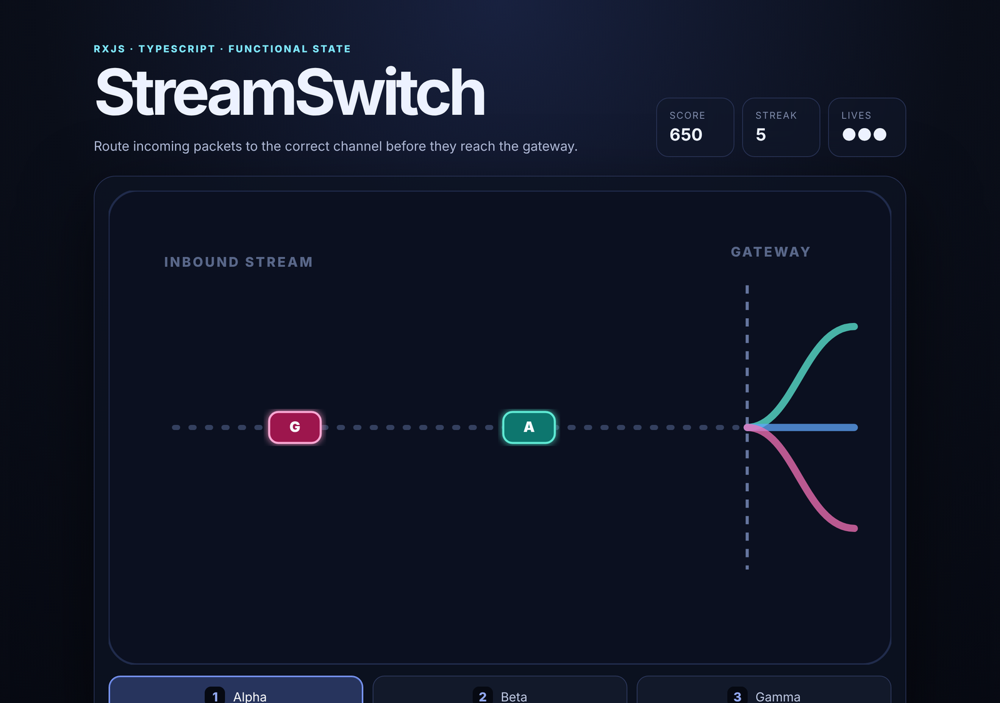

# StreamSwitch

[](#)
[](#)
[](LICENSE)
[](https://github.com/Waldo0926/streamswitch/actions/workflows/ci.yml)

[English](README.md) · **中文**

> 一个基于 RxJS 的响应式数据包路由小游戏，用不可变状态、确定性模拟和可测试事件流实现。

StreamSwitch 是一个用来探索 **Functional Reactive Programming（函数式响应式编程）** 的独立浏览器项目。它把问题建模成数据包路由：数据包不断进入网关，每个数据包属于三条路线之一，你需要在它抵达前选择正确的 Alpha / Beta / Gamma 通道。

我真正想展示的不是小游戏本身，而是代码组织方式：键盘、鼠标、计时器、暂停、页面可见性、随机生成和重新开始都被建模成 Observable；游戏规则保持为纯函数；DOM 渲染被隔离在系统边界。

## 为什么做这个项目

我想用一个小项目把学函数式编程和 RxJS 时觉得最有用的几个思路串起来：

- 整个应用只有一个不可变状态（immutable state）；
- 将外部事件统一转换成 typed actions；
- 使用纯 reducer 管理状态变化，行为容易测试；
- 用 Observable gate 处理暂停，而不是散落的 mutable flag；
- 使用确定性的伪随机数，让同一个 seed 可以复现相同模拟；
- 将 DOM 操作与状态逻辑分离。

StreamSwitch 有自己独立的领域、数据模型、UI、reducer 设计、确定性随机算法、测试和文档。

## 玩法



数据包从左边进入，带有三种路线标记之一：

- **A** → Alpha
- **B** → Beta
- **G** → Gamma

在数据包到达网关前选对路线。选对会增加分数和连击（streak），选错会扣一条命。随着时间推移，数据流会越来越快。

| 操作 | 作用 |
| --- | --- |
| `1` / `2` / `3` | 选择 Alpha / Beta / Gamma |
| `↑` / `↓` | 切换路线 |
| 鼠标 | 点击路线按钮 |
| `P` | 暂停 / 恢复 |
| `R` | 用新的确定性种子重新开始 |

## 架构

```text
浏览器事件 + 计时器 + 页面可见性
              │
              ▼
        RxJS Observables
              │
              ▼
         typed Actions
              │
              ▼
      scan(reduceState, state)
              │
              ▼
       immutable GameState
              │
              ▼
           render()
              │
              ▼
          SVG + HTML
```

### 纯模型

`src/model.ts` 包含 reducer 和全部模拟规则。它不读取 DOM、当前时间或随机数，同样的状态和 action 一定得到同样的下一个状态。

这里没有用 action class，而是用 **discriminated union**：

```ts
export type Action =
    | { type: "tick" }
    | { type: "spawn"; route: Route }
    | { type: "select-route"; route: Route }
    | { type: "set-paused"; paused: boolean };
```

这样每种状态转换都写得很明确，TypeScript 也能检查是否处理了所有 action。

### Stream 层

`src/streams.ts` 把浏览器事件和计时器转换成 action。`gatedBy` 是一个自定义的小 operator，在暂停或页面隐藏时丢弃游戏事件。

重新开始是切换到一条新的状态流。这样每一局都是一条可以直接丢掉的响应式管道，而不是一个需要逐个字段手动重置的可变对象。

### 确定性模拟

`src/random.ts` 使用 `xorshift32`。随机数在 reducer 之外生成，再转成普通的 `spawn` action。所以一局的 seed 就完全决定了数据包类型和生成间隔，调试和测试都比在状态逻辑里直接调用 `Math.random()` 方便很多。

## 项目结构

```text
src/
  domain.ts    共享类型和配置
  model.ts     纯状态转换
  random.ts    确定性伪随机数生成器
  streams.ts   RxJS 事件 / 计时器管道
  render.ts    只负责 DOM/SVG 渲染
  main.ts      组装入口
  style.css    界面样式

tests/
  model.test.ts
  random.test.ts
  streams.test.ts

docs/
  ARTICLE.md
  ARTICLE.zh-CN.md
```

## 本地运行

```bash
npm install
npm run dev
```

构建与测试：

```bash
npm run build
npm test
```

GitHub Actions 会在推送到 `main` 和针对 `main` 的 PR 上自动跑 `npm ci`、`npm test` 和 `npm run build`。

## 之后想加的东西

- 难度预设和无障碍设置；
- 用 seed + 输入记录生成的回放文件；
- 一个显示各条 Observable 速率的小面板；
- 针对 reducer 不变量的 property-based 测试；
- 手机上的触摸手势。

## 技术文章

更完整的技术文章见 [用 RxJS 写一个小型响应式模拟器](docs/ARTICLE.zh-CN.md)，也有 [英文版](docs/ARTICLE.md)。

## 许可证

MIT，详见 [LICENSE](LICENSE)。
